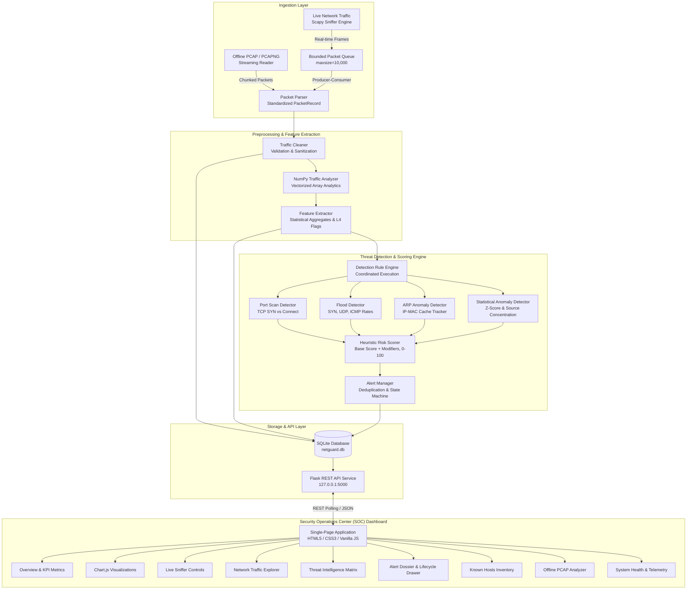
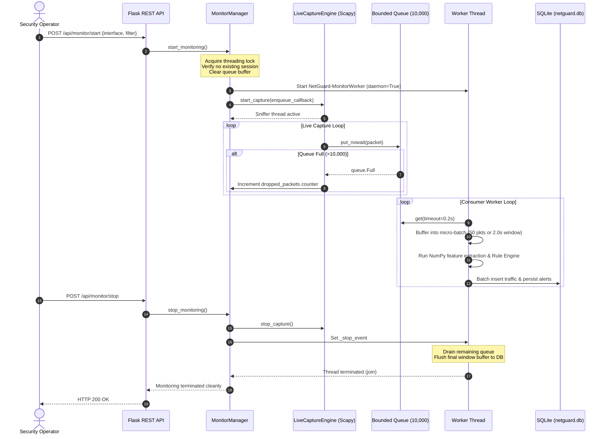
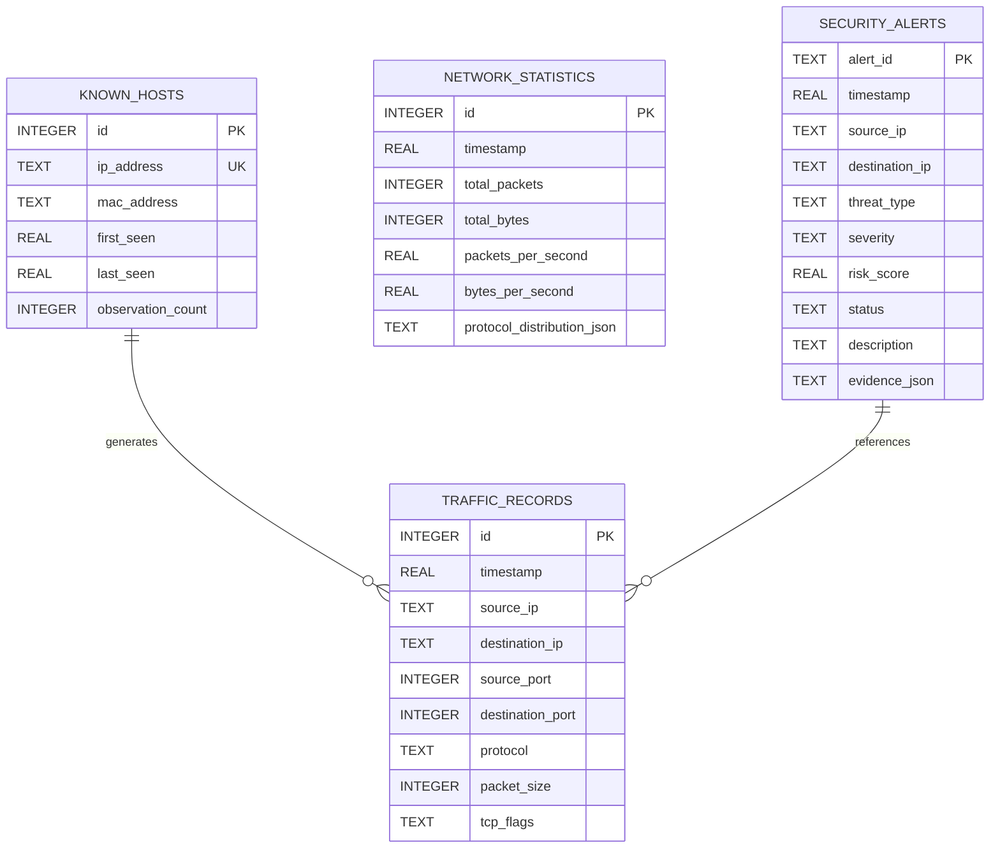

# NetGuard — System Architecture Documentation

This document describes the architectural design, data pipelines, thread lifecycle, and storage models of **NetGuard**, an enterprise-grade Network Intrusion Detection System (NIDS).

---

## 1. End-to-End System Architecture

---

## 2. Ingestion & Threading Lifecycle

NetGuard separates live packet capture from analytic processing using a **multi-threaded producer-consumer pattern**:

### Key Concurrency Protections:
1. **Re-entrancy Guard**: Starting a capture session while one is already active raises `RuntimeError` and returns `HTTP 409 Conflict`.
2. **Backpressure Handling**: If the queue fills past 10,000 items, packets are dropped and accounted for in `dropped_packets` rather than consuming unbounded system memory.
3. **Graceful Drain**: When stopping, the worker thread continues draining all remaining queue elements and flushes its buffer to SQLite before exiting.
4. **Isolated Exceptions**: Database write failures or malformed packet anomalies caught inside the worker loop are logged to `last_error` and do not crash the sniffer thread.

---

## 3. Data Pipeline & Detection Architecture

### A. Preprocessing & Normalization
1. **`PacketRecord`**: Normalized dataclass containing:
   - `timestamp` (float)
   - `src_ip`, `dst_ip` (IPv4 or IPv6 string)
   - `src_mac`, `dst_mac` (Normalized lower-case MAC)
   - `src_port`, `dst_port` (Integer or None)
   - `protocol` (`TCP`, `UDP`, `ICMP`, `ARP`, or `OTHER`)
   - `packet_size` (Integer byte length)
   - `tcp_flags` (String representation, e.g. `SYN`, `SYN-ACK`, `ACK`, `FIN`, `RST`)
2. **`TrafficCleaner`**: Verifies valid timestamps, normalizes IP addresses, strips invalid headers, and flags anomalies.

### B. Feature Extraction (NumPy)
The `NumPyTrafficAnalyzer` module performs zero-copy vectorized calculations over packet batches:
- Vectorized sizes: mean, standard deviation, min, max, percentiles (p25, p50, p95).
- Transfer rates: packets per second (PPS) and bytes per second (BPS).
- Unique entities: unique source IPs, destination IPs, and destination ports using `np.unique()`.
- Protocol breakdown and TCP flag distributions.

### C. Coordinated Threat Detectors
1. **`PortScanDetector`**: Tracks sliding windows of destination ports per source IP against a target. Differentiates single-port multi-packet bursts from genuine reconnaissance probing $\ge 15$ ports in 10.0s.
2. **`FloodDetector`**: Measures instantaneous volumetric rates:
   - **SYN Flood**: Evaluates TCP SYN-only packets exceeding 80.0 PPS with minimum 50 packets.
   - **UDP Flood**: Evaluates UDP volume exceeding 100.0 PPS with minimum 60 packets.
   - **ICMP Flood**: Evaluates echo requests exceeding 40.0 PPS with minimum 30 packets.
3. **`ARPAnomalyDetector`**: Maintains an IP-to-MAC association state cache. Identifies conflicting MAC mappings for existing IP records within observation windows.
4. **`StatisticalAnomalyDetector`**: Evaluates burst spikes against baseline rates ($\ge 500$ PPS), packet size Z-scores ($Z \ge 3.0$), and high source concentration ratios ($\ge 90\%$).

### D. Heuristic Risk Scoring
Base threat weights are adjusted based on empirical evidence:

$$\text{Final Score} = \text{np.clip}\left(\text{Base Score} + \sum \text{Modifiers},\; 0,\; 100\right)$$

- Base Scores:
  - `PORT_SCAN`: 60.0
  - `SYN_FLOOD`: 90.0
  - `UDP_FLOOD`: 85.0
  - `ICMP_FLOOD`: 75.0
  - `ARP_ANOMALY`: 85.0
  - `STATISTICAL_ANOMALY`: 40.0
- Severity Boundaries:
  - **CRITICAL**: 80 – 100
  - **HIGH**: 60 – 79
  - **MEDIUM**: 30 – 59
  - **LOW**: 0 – 29

---

## 4. Database Schema (SQLite)

NetGuard persists network telemetry in `netguard.db` using 4 indexed relational tables:

---

## 5. Security & Isolation Controls

1. **Localhost Binding**: Flask binds strictly to `127.0.0.1:5000` by default; it is never exposed to public interfaces (`0.0.0.0`).
2. **PCAP Upload Sandboxing**:
   - Magic byte header inspection validates genuine PCAP/PCAPNG signatures before reading.
   - Files are stored in secure OS temp files (`tempfile.mkstemp`) and deleted in a `finally` block on both success and failure.
   - Client filenames are sanitized with `os.path.basename` to prevent directory traversal.
   - Maximum upload size is strictly capped at 10 MB (HTTP 413).
3. **SQL Injection Resistance**: All SQL queries utilize parameterized statements (`?` placeholders) through connection context managers.
4. **XSS Protection**: Frontend rendering escapes all dynamic strings (`Utils.escapeHTML()`) or uses `.textContent` for JSON payloads.
